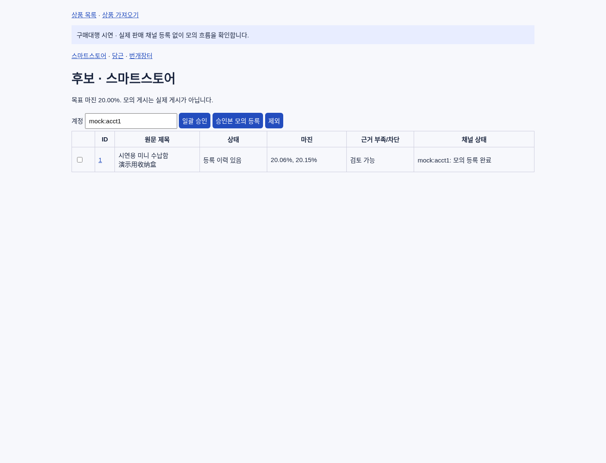

# 구매대행 1단계 구현 (T-COMMERCE-001)

범위: 로컬 기반(가져오기·가격·저장·검토 화면·승인·모의 게시·초안 내보내기). **실계정 게시/장바구니/구매/결제 없음. 실제 타오바오 수집 없음.**

## 구성 (`app/purchasing/`)
| 파일 | 역할 |
| --- | --- |
| `importer.py` | JSON(schema_version=1)/CSV 가져오기와 검증. 외부 텍스트·HTML은 저장만 하고 화면에서 이스케이프 |
| `pricing.py` | Decimal 가격 엔진 (배송 포함/별도, 채널 요율, 고정 수수료, 충당금, 환율, 부피중량, 할인, 시나리오) |
| `store.py` | SQLite(표준 라이브러리). 상품/옵션/번역/견적/승인/게시/시도/실행/감사 기록, 비밀키 마스킹 |
| `workflow.py` | 견적 → 승인(내용 해시, 24h 만료) → 원자적 점유 게시 → 주간 실행 → 초안 내보내기, 모의 어댑터 |
| `web.py` | 루프백 검토 화면 (Basic 인증 + Origin 검사 + CSP). 비밀번호 기본값 없음 |
| `cli.py` | `weekly-mock` 주간 모의 실행 |

기존 코드 재사용 판단: 기존 `Product`(공급가/판매가 1개, 승인 불리언)는 옵션·채널별 견적과 승인 버전을 표현할 수 없어 기존 테이블과 분리된 신규 모듈로 구현했다. 기존 `app/*` 파일은 수정하지 않았다. 기존 진입점 불일치(`start_auto_naver.bat`=`app.main_v31:app`, README/Dockerfile=`app.main:app`)는 건드리지 않았고, 신규 화면은 별도 진입점 `app.purchasing.web:app_from_env`를 쓴다.

## 정책 요약
- 예상 공헌이익률 = (고객 실결제액 − 총원가 − 판매수수료 − 고정수수료) / 실결제액. 고정비·소득세 차감 전, 이익 보장 아님.
- 원단위: 원가 항목은 원 단위 올림, 수수료는 건별 원 단위 반올림(HALF_UP), 판매가는 100원 단위 올림 후 마진 재검산(미달 시 한 단위씩 상승).
- 환율 24시간, 배송 요율/채널 수수료 30일 초과 시 만료 → 가격 확정(publishable) 불가. 누락값을 0으로 대체하지 않는다.
- 승인은 상품·옵션·이미지·번역·견적 입력/결과의 해시를 저장. 게시 직전 해시·만료·견적 유효기간 재검사.
- 게시 점유는 `BEGIN IMMEDIATE` 트랜잭션 + (상품, 채널, 계정) 유일 키. 응답 유실/예외는 `unknown`이며 재POST하지 않고 조회로만 정리. 강제 종료로 남은 `claimed`도 조회로 정리.
- 실채널(스마트스토어/당근/번개장터)은 `REAL_CHANNELS_VERIFIED=False` → `blocked`. 모의 어댑터는 `mock:` 계정에만 사용.
- 집계: `mock_published`(모의)와 `real_published`(실제)를 분리. 초안 내보내기는 게시 성공으로 집계하지 않음.

## 테스트
```
python -m venv .venv && .venv\Scripts\activate    # Windows
pip install -r requirements-dev.txt
python -m pytest -q tests/purchasing
```

## Windows 실행 (미검증)
- 최초 설치: `purchasing_install.bat`을 실행한다. 최신 Python Install Manager(`py`)가 있고 Python 3.12 런타임이 없으면 `py install 3.12`로 공식 런타임을 설치한 뒤 가상환경·의존성 설치를 이어간다. 인터넷 연결이 필요하다. 구형 실행기이거나 자동 설치가 실패하면 원인을 표시하고 중지한다. 이 경우 공식 Python Windows 다운로드에서 3.12를 설치하고 다시 실행한다.
- 시작: `purchasing_start.bat` 실행 → 8자 이상 암호 입력 → Chrome에서 http://127.0.0.1:8765 열기 (Basic 인증, 사용자 `reviewer`). 암호는 파일에 저장하지 않는다.
- 중지: `purchasing_stop.bat` (같은 가상환경의 검토 앱인지 확인 후 종료; 다른 프로세스면 거부) / 재시작: stop 후 start
- 예약(월 09:00 제안값): `schtasks /Create /SC WEEKLY /D MON /ST 09:00 /TN "PurchasingWeeklyMock" /TR "\"%CD%\purchasing_weekly.bat\""` — 실행 전 사용자 확인 필요. 이 저장소 작업에서는 예약을 만들지 않았다.
- 위 .bat 파일과 예약은 Linux 환경에서 작성만 했고 **Windows 실환경(잠금/절전/재부팅/미로그인) 검증은 하지 않았다.**

## 남은 제약
번역 수치/단위 자동 대조(2단계), 근거 기반 트렌드 점수(2단계), 타오바오·실채널 연동(3~4단계), Windows 실환경 검증(5단계)은 미구현/미검증. 검토 화면에서 상품 파일 가져오기·비용 입력·가격 계산·번역 입력/검수·승인·모의 게시·ZIP 다운로드를 진행할 수 있다. 자동 번역은 연결 전이므로 시연에서는 직접 번역문을 입력한다.

## 2026-11-05 후속 수정
- 수입된 옵션의 비용 미입력은 확인된 0원과 구분하여 견적을 보류한다. 비용 6개 필드(중국 배송, 검수/포장, 판매자 통관, 국내 배송, 결제비율, 충당금 비율)는 0인 경우도 명시한다.
- 원가/옵션 변경은 재견적을, 원문 변경은 번역 재검수를 요구한다. 현재 옵션과 견적 입력이 일치해야 재승인할 수 있다.
- CSV 공통 상품 정보가 옵션 행마다 다르면 상품 그룹 전체를 거부한다. 잘못된 제한 플래그는 해당 상품만 거부한다.
- 기존 판매가 평가에도 수수료 누락/만료 검사와 고정비 검증을 적용한다.
- 조회 미발견은 처리 중인 외부 요청이 없다는 증거가 아니므로 unknown을 유지한다. 자동 재POST하지 않는다.
- Windows의 Asia/Seoul 시간대 데이터를 위해 tzdata를 설치 의존성에 추가했다. 종료 시 다른 프로그램의 프로세스를 종료하지 않도록 실행 파일과 명령을 확인한다.
- Windows 실환경 및 종료 PowerShell 실행은 미검증이다. 실제 채널 차단은 유지한다. UI는 아래 시연 기능에서 보완했다.

## 2026-11-05 화면 시연 기능
1. 상품 가져오기 → 가상 상품 샘플 다운로드 → 파일 선택 → 가져오기.
2. 상품 목록에서 ID 클릭 → 비용·중량·규격 및 확인한 환율/요율 입력 → 전 옵션 가격 계산. 샘플값은 가상 상품에만 제공한다.
3. 한국어 상품명·상세 설명·옵션명 입력 → 초안 저장 → 원문과 대조 → 이 번역 검수 완료.
4. 모의 계정(mock:acct1)으로 상품 승인 → 승인본 모의 등록. 같은 상품을 다시 등록해도 중복 생성하지 않는다.
5. 검토용 상세페이지 ZIP 다운로드로 설명·이미지 URL 목록·옵션별 가격 자료를 받는다. DRAFT 파일이며 실제 게시로 집계하지 않는다.

가상 상품의 이미지와 공급처 URL은 example.invalid를 사용하며 접속하지 않는다. 실제 판매 요율·수요·판매 적합성을 의미하지 않는다.
새 입력 화면은 원문/번역 버전 변경을 검사하며, 이전 화면으로 번역을 저장하거나 예전 번역을 검수하면 거부한다.
검증: 전체 자동 테스트 88개 통과, Linux Chromium에서 실제 파일 업로드부터 ZIP 다운로드까지 통과.
Windows 설치·암호 입력·PowerShell 실행·예약은 Windows PC에서 아직 검증하지 않았다.

### 재현 가능한 브라우저 검사
개발 의존성을 설치하고 Chromium 경로를 PURCHASING_CHROMIUM에 지정한 뒤 `python scripts/purchasing_browser_smoke.py`를 실행한다.
검사는 임시 DB/무작위 로컬 암호로 서버를 시작하여 가상 상품만 사용하며, 종료 후 해당 서버를 정리한다.
화면 캡처와 서버 로그는 Git에서 제외된 `artifacts/purchasing-ui/`에 저장한다. 실제 운영 DB는 사용하지 않는다.


